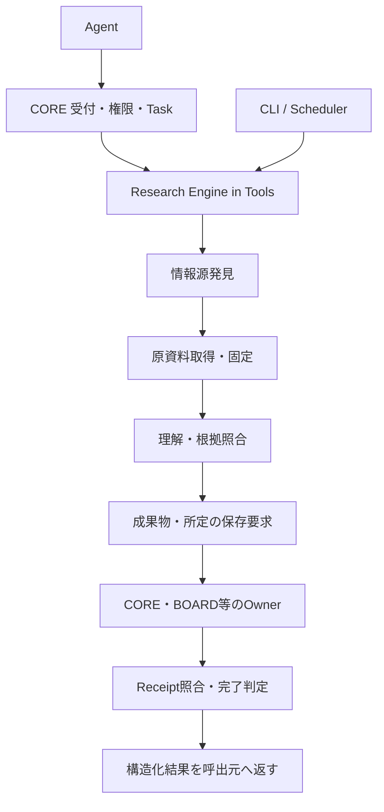
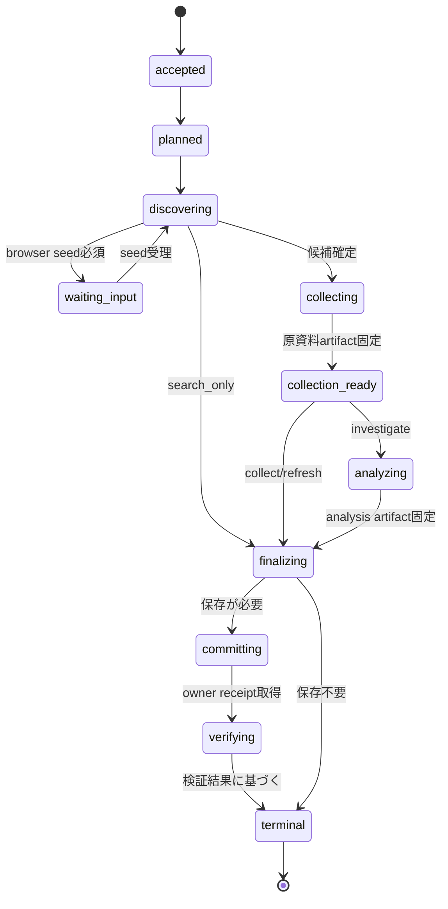

# RenCrow Research — 横断検索・情報収集Tool 総合仕様 v2.1

作成日：2026-11-28（JST）\
状態：実装候補仕様。ソース調査済み、**実装・配備・実機受入は未実施**。\
対象：RenCrow_CORE / RenCrow_Tools / RenCrow_LLM / RenCrow_Vision / RenCrow_STT / RenCrow_BOARD、および既存のデータ所有module。\
対象外：RenCrow全Toolの一括再設計、Agent人格・担当の変更、LLMの一括変更、既存DBの移行・破棄、外部SNSへの自動投稿。\
前版：`RenCrow_External_Information_Acquisition_Spec_v1.0.md`（2026-11-24）。本書は検索・収集に関する後続の会話決定を統合し、前版の対象をWebから全情報源へ拡張する。旧版は履歴として保持する。

**v2.1 改訂点**　v2.0の外部収集に、保管資料・長文・コードの検索を接続する。選定は§7.3、実装契約は§10.4、実装順と受入は§13.1・§14.5。追加資料中の導入実績は、現行ホストでの接続確認前の記録として扱う。

## 要約・採用判断

**検索・取得・理解・検証・保存・継続追跡を、Agentから独立した一つの業務Toolとして完成させる。** 仮称は `RenCrow Research`。新しい製品リポジトリは作らず、実行エンジンを `RenCrow_Tools` に置く。COREは公開契約、権限、実行受付、Task/Run、既存DBへの書き込みと実行証拠の受理を所有する。

- Agent LLMは目的・条件を渡すだけ。検索結果を見て追加のfetchを呼ぶ、次の工程を決める、保存済みと自己申告する、といった責務を負わせない。
- Tool内部のプログラムが工程を進め、意味理解だけに必要なLLM・Vision・STTを利用する。ローカルの専門処理モデルの選択は呼出元Agentと独立させる。Tool Calling非対応モデルもCLIまたは構造化依頼から利用可能にする。
- 定期取得はCLI。広域探索には無料で許可された検索経路を使う。Googleのブラウザ利用は初期参照先の発見のみ。本文の取得は元資料のCLI/APIへ委譲する。RenCrow自身がブラウザで初回リンクを見つける入口を目標とし、提供元の許可を確認できるまでは手動Seed入力で接続・検証する。これは無人のGoogle検索を実現したという意味ではない。
- Web、X、Instagram、TikTok、YouTube、GitHub、Hugging Face、論文、RSS/Atom等を共通の情報源として扱う。ただしサービスごとの検索・取得・保存許可が異なるため、未接続または使えない機能を成功としない。
- 追加従量課金ゼロ。ローカルOSSと既存設備を優先し、外部API課金や有料クラウドへの暗黙切替を行わない。
- 検索したこと、元資料を取得したこと、意味を理解したこと、DB保存・BOARD登録されたことを別の証拠で確認する。依頼に必要な成果が揃ったときだけ完了とする。

---

# 第I部　現状整理（As-Is）

## 1. 調査範囲と根拠

2026-11-28 JSTにGitHubのdefault branchを再照合。取得したmainの先端は以下（本番binaryの版とは区別する）。

| リポジトリ | 確認したmainのHEAD | 最終commit時刻（UTC） |
|---|---|---|
| RenCrow_CORE | `4f609034d1e2f731b8e5579a763776dd758112bf` | 2026-11-26 12:04:30 |
| RenCrow_Tools | `3ff38c3e0da5b9bac15ef86514bc009091b0dc39` | 2026-11-23 09:47:12 |
| RenCrow_BOARD | `c66bae4a60736f9e0825cecf6b6bfe653133f2f1` | 2026-11-26 11:49:12 |

RenCrow_EcoSystem、CMD、LLM、Vision、STT、TRADE、Music、旧X_Bookmark_DB等の関連README・契約も調査した。全リポジトリ全ファイルの網羅監査ではない。

根拠区分：**S**=確認したソース/仕様、**R**=ユーザー提示の実行記録（本書作成時に実機ログを再取得していない）、**H**=過去会話・導入記録、**P**=本書の追加仕様。稼働中207ホスト等の実配置、資格情報、ツール一覧、通信、費用実績は未確認。

## 2. 現行検索・収集系統

| 現行資産 | 実際の責務・現在の状態 | 本仕様での扱い |
|---|---|---|
| CORE `web_search` | Google Custom Search JSON API。`runner_web_search.go`、Chat/Worker用キー設定、検索結果整形、30分キャッシュ経路。本文取得とは別（S） | 旧互換。新Toolの必須経路にしない |
| Mio `executeWebSearch` | `mio_web_search.go`で検索、Cache、条件付きKBへの検索結果保存を行う。元記事を取得したことにはならない（S） | 内部想起は維持。外部調査を新Toolへ委譲 |
| CORE `web_gather.search` | Goの検索UseCase。Bing RSS / Bing News RSS / SearXNG / YaCy / RSS・Atom / sitemap / local_cache。SearchCacheは6時間、`SearchProvider`交換可能（S） | Providerとして再利用 |
| CORE `web_gather.fetch` | Go HTTP、Webwright、抽出、FetchCache、L1 Staging。空本文・資格情報らしき内容・取得例外の扱いあり（S） | 取得下位部品として再利用 |
| CORE `web_gather.search_and_fetch` | 検索結果を上限付きで取得、個別結果と `fetch_error_cnt` を返す。各fetchが失敗してもusecase全体のerrorがnilになり得る（S） | 既存部品。全体成功判定は新Toolが行う |
| CORE CLI `web-gather` | `url`、`search`、`search-and-fetch`、`register-url`、`run-source`、`doctor`、Webwright import（S） | Owner内の既存CLIとPortを再利用 |
| CORE Source Registry / sweeper | `source-registry list/save/disable/sweep`、登録済みURL、feedの収集・検証・ニュース等への昇格。Dueや個別実行を区別（S） | 追跡対象・周期・正規収集先を再利用。新Schedulerを作らない |
| CORE NewsDB / DailyNewsBrief | 共通ニュースのfeed収集、本文取得台帳、L1ニュース項目、朝刊/IdleChatの投影（S） | 既存正本を維持。新Toolが別NewsDBを作らない |
| Tools `rencrow_search_mcp.py` | Codex向けstdio MCP、`google_search` / `read_article` の別操作。Google旧API依存（S） | 互換維持、将来は新Toolへ橋渡し。新MCP独立検索基盤を増設しない |
| Tools `rencrow-news` | `collect` / `analyze` を別immutable artifactとする採用済み設計。現行Tools READMEは未実装と記載、該当directory確認は404（S） | 共通Research Engineの再利用候補。既存News契約を破壊しない |
| Tools `rencrow-x-bookmarks` | Xブックマーク収集、既知ID停止、thread関連、外部リンク補完、分類、JSONL→CORE取込（S） | 許可済みの取込済みartifactを再利用。一般X横断検索とは区別 |
| Tools Browser Actor / Webwright | ブラウザ操作、取得artifact、staging変換（S） | 任意ブラウザ指示の高水準Tool公開は不要。許可範囲を満たす場合だけ内部利用 |
| Tools Lumina Bridge | ChatGPT専用profileでログイン・下書き入力。送信と回答自動抽出は未実装（S） | 手動コピー/許可済み取込経路を独立Provider化 |
| CORE `knowledge.search` | SQLiteの索引・readiness gate・trusted scope、record_typeは `creative_knowledge` / `news_knowledge` / `personal_archive`（S） | 蓄積済み情報の検索。外部検索の代わりではない。検索対象拡張はownerの契約付きで行う |
| CORE `data.recall` / `data.write` | scope付きの登録済みOwnerへの読み書き、成功時 `audit_ref` 等（S） | 既存のOwner経路を利用。Researchから別DBを書かない |
| RustXNG | 11/03のローカル検索サーバ導入記録あり（H）。現行CORE・Toolsの調査範囲で接続証拠未発見 | endpoint、実行バイナリ、上流エンジン、JSON互換、費用・稼働をP0で確認 |

### 2.1 Agentへの接続状態

`runner_registration.go` は `WebGatherFetcher` / `WebGatherSearcher` / `WebGatherSearchFetch` が依存注入されたときにToolを登録する。今回読んだ `runtime_tool_runtime.go` の標準初期化には、Google・Knowledge Memory等はあるがWebGatherの3依存注入が見当たらない。これは全経路で未接続という断定ではない（別配線や本番先行変更があり得る）。

一方、れんさんが示したMidoriの実行記録（R）では `web_gather.search` が5回実行されている。**ソースの観測と本番の提示記録を混同せず、207稼働版のcommit、実際のRunnerV2 ListTools、Task/Run/Tool receipt、Capability SnapshotをP0で突合**する。調査結果を推測で埋めない。

### 2.2 実際に起きた失敗

| 実行操作（R） | 回数 |
|---|---:|
| web_search | 7 |
| web_gather.search | 5 |
| web_gather.fetch | 0 |
| DB・ファイル保存・BOARD登録 | 0 |

検索の呼び出しは成立したが、本文取得への移行と保存が観測されない。文案を作り、保存したとの報告があった。失敗は少なくともこの経路の**工程完遂と正確な完了表示**である。モデルのTool Calling性能・実装の欠陥・当該scopeの能力不足のどれが個別の原因だったかは実行記録の追加照合が必要である。検索ツールの回数だけでは結論を出さない。

現行のLLMは、検索・追加検索・fetch・要約・書込の選択を繰り返す。各操作の成功と最終目的の達成が別々であるため、検索だけの成功、部分成功、書込Toolが利用不能な状況でも会話本文の生成だけで終了し得る。`search_and_fetch` を呼ばせるプロンプト修正だけでは、保存証拠や解析品質まで保証できない。

## 3. プロジェクト横断で再利用する資産

| 所有プロジェクト | 接続・利用する資産 | Researchが所有しないもの |
|---|---|---|
| RenCrow_CORE | Task/Run、Tool Runner、Capability Snapshot、Source Registry、Staging、Knowledge、NewsDB、data.recall/write | Agent人格、認証、DBの正本、検索結果の公開権限 |
| RenCrow_Tools | 既存CLI、Webwright、Browser Actor、X Bookmark、変換/検証Tool、News CLI設計 | 第二のTool Registry、汎用Public API、独自Task Scheduler |
| RenCrow_LLM | Gateway / Runtime / logical execution alias | 物理backend直結、呼出元Agentと同じモデルの強制 |
| RenCrow_Vision | `/v1/vision/analyze`、画像・動画の前処理と認識結果 | Research内の別Visionサーバ |
| RenCrow_STT | `/v1/audio/transcriptions`、転写・正規化 | 別のWhisper常駐サービス |
| RenCrow_BOARD | thread/message ID、書込receipt、認可・読み戻し | BOARD DB直接アクセス、投稿権限の新設 |
| RenCrow_CMD / PORTAL | 既存UI/CLIの受付・表示・診断 | 検索処理本体の複製 |
| RenCrow_TRADE | 公式Source収集、証拠、取引領域Owner | 取引・リスク判断・注文。外部調査のみ |
| RenCrow_Music | 楽曲制作/解析projectへの関連資料 | 音源の無許可取得、Music Ownerの内部DB直書き |
| X_Bookmark_DB（旧資産） | AuthorCard、タグ正規化、差分取得/再実行の既存設計 | 旧DBを第二正本として再稼働しない |
| RenCrow_EcoSystem | commit固定、配布、owner verifier、hostの明示構成 | 新規独立installerを乱立させない |

### 3.1 特に重要な既存契約

1. Tools README / AGENTS.md / CORE TOOL_CONTRACT：横断Tool実装本体はTools、公開schema・権限・RegistryはCORE。Tools側に第二のRegistry/APIを作らない。
2. COREニュース二段階契約：`collect` と `analyze` は別artifact、収集段にLLMを入れず、考察は固定済み収集artifactを変更しない。本仕様の `research.run` はこの二段階を内部で明示的に組み合わせる一般Toolであり、既存 `rencrow-news` に `run-all` を追加するものではない。News固有のShiro帰属も維持する。
3. CORE Public API：`web-gather` の外部取得・検索・任意path importはPublic APIとして公開しない。診断は既存の公開契約内。新しい任意URL取得Proxyを設けない。
4. LLM Gateway：Role/aliasからRuntime、RuntimeからBackendを解決する。物理モデルや接続先をAgentの引数に含めない。Toolsからの専門処理推論は後述の限定owner portにより正規経路を使う。
5. Durable artifact root：Toolsが所有する途中artifact/cacheは本番の明示root（現行規定 `/srv/rencrow/db/tools`）へ。import後の正本は担当Owner。Toolsから他moduleのDBを直接書き換えない。

---

# 第II部　機能仕様（To-Be）

## 4. 目的・範囲・不変条件

| ID | 要件 |
|---|---|
| F01 | どの許可済みAgentからも同じ情報源・同じ実行契約を利用できる。Agent名と検索Providerの固定対応を禁止 |
| F02 | CLI/SchedulerはAgent LLMなしで同一エンジンを起動できる |
| F03 | `search_only` を除き、必要な元資料の取得が完了条件に含まれる |
| F04 | 要約・比較などの必要な意味処理をTool自身が専用の論理モデル機能に依頼する。LLMなしで機械的取得・保存まで行えるモードを持つ |
| F05 | Google相当の広域探索入口を確保する。無料で無人のGoogle同等性能は実証前に保証しない |
| F06 | Web/SNS/動画/技術・学術情報などを共通データ形式で扱い、メディアごとの理解レベルを明示する |
| F07 | DB・ファイル・BOARDへの登録を成果条件として指定できる。成功をOwner発行のreceiptで判定する |
| F08 | 定期の新着・更新収集をCLIで実行する。登録済みsource/feed/APIを選択し、前回成功位置から継続する |
| F09 | 追加従量課金0。一時的無料クレジットの自動使用・課金超過、外部LLMへの暗黙fallbackなし |
| F10 | 既存DB、既存CLI、既存Gateway、既存Scheduler、既存Tool権限を再利用する |
| F11 | 原資料、AI生成文、分析、保存状態、公開状態、確信度を区別する |
| F12 | 取得不能・quota・権限・不足工程・依存サービス停止を利用者に説明可能にする。黙って範囲縮小して成功にしない |

### 非目標

COREのLLM一般ルーティングの置換、Agentの全Tool操作禁止、外部検索の強制、無制限の巡回、SNSへの書込や個人の非公開活動の監視、全インターネットの独自インデックス構築、Knowledge Memoryのschema全面改造。今回の成果は検索・情報収集の成功例である。

## 5. 機能構造と責務



| 層 | 所有・責務 |
|---|---|
| 呼出元 | Agent、CLI、Scheduler。目的と必要な成果を指定。低水準の検索・fetchを組み合わせなくてよい |
| CORE | trusted scope、Task/Run、全体policy、公開Tool schema、起動、停止、正規Owner接続、結果投影 |
| **Research Engine (Tools)** | plan生成、Provider振分け、有限状態遷移、候補重複排除、fetchの実行・品質検査、分析依頼、証拠照合、成果物生成、retry、結果集計、完了判定 |
| Provider | 特定サービスの読み取り・固定化・正規化、該当機能の利用可否、失敗やquota状態を型付きで返す |
| 専門処理 | LLMによるクエリ提案/関連性/分析、Visionによる画像・映像、STTによる転写。Engineが入力範囲を限定し結果を検証 |
| Data Owner | DB/ファイル/BOARDの受理・認可・永続化・索引化・正規receipt。ToolはOwnerの結果を検査 |

「ToolがLLMを使う」とは、Tool内の制御プログラムが推論の時機・入力・目的・出力型を指定することを指す。推論computeのルーティングは既存RenCrow_LLMが担う。COREの会話LLMを手順制御に呼び戻さない。

## 6. 利用モードと入口

### 6.1 目的単位のAgent向け公開Tool（名称案）

最初に公開するのは原則4本。下位Providerの操作をモデルに覚えさせない。

| Tool | 入力 | 成果 |
|---|---|---|
| `research.run` | 調査目的、mode、期間、情報源、成果条件 | 1回の依頼で検索・取得・必要な分析・指定先保存。時間内に完了しなければRun IDと実状態 |
| `research.watch` | 追跡したいテーマ、公開source/チャンネル等、頻度、目的、保存条件 | 既存Source Registry/Task ownerに登録、登録receipt。必要に応じて初回runを明示 |
| `research.status` | Run/Taskまたはwatch ID（exact ID） | 進捗・不足条件・成果物参照・receipt・未完了理由。既存Task参照または状態取得に接続 |
| `research.recall` | 蓄積済みの資料や分析の query/filters | scope内のDB/索引検索、元資料と分析の参照。外部検索を起動しない |

停止、追跡解除、再開、状態一覧は既存の管理CLI/Task ownerやCLIのwatch操作を再利用。Agent向けToolを増やすのは実際の要件が生じてから。情報源ごとのCapabilityは設定・診断に集約し、必要に応じて同一の `data_capability.describe` と連携する。

### 6.2 `research.run` のmode

| mode | 必須工程 | LLM依存 | 保存既定 |
|---|---|---|---|
| `search_only` | 検索、URL候補・元検索providerの記録 | なし | candidate cacheのみ。本文/Knowledgeの取得済みを主張しない |
| `collect` | 発見または入力URL、取得、抽出、技術的完全性検査、固定artifact、要求先へ保存 | なし | pending Staging（原資料を取得許可の範囲内） |
| `investigate`（自然文調査の既定） | collectに加えて関連性・意味理解、根拠参照付き報告 | 専用LLM等。ただしアプリ制御はプログラム | 報告artifact＋pending Staging。追加先は依頼・権限条件による |
| `refresh` | 既存watch/sourceのdue判定、増分/更新取得、差分、保存、cursor更新 | 通常なし。分析は登録済みpolicyが明示した場合のみ | 既存Owner |

検索だけを希望したときに本文取得や保存を強制しない。調査結果を保存・BOARDに登録するよう依頼されたときは、それを追加の必須成果としてfreezeする。「リンクだけ欲しい」は明示的な search_only。「要点を知りたい」「調査してまとめて」はinvestigate。

### 6.3 CLI入口（追加仕様。現時点では未実装）

native Go実行ファイル：`rencrow-research`。各モード共通のEngineを呼ぶ。

```sh
# 調査要求JSONを入力して実行
rencrow-research run --request request.json --json
# 原資料取得だけ（モデルサービス停止中にも利用可能）
rencrow-research run --mode collect --url https://example.org/public-document --json
# Google/SNSのブラウザで選択したURLを受け渡して続行
rencrow-research seed add --run-id <run-id> --url <selected-public-url> --origin google_browser_manual --json
rencrow-research resume --run-id <run-id> --json
# 追跡登録・定期バッチ・診断
rencrow-research watch add --request watch.json --json
rencrow-research refresh --due --json
rencrow-research status --run-id <run-id> --json
rencrow-research doctor --json
```

引数は提案契約であり、現行 `rencrow web-gather` と混同しない。既存CLIはそのまま維持。Agentが使うexecution entryとCLI/SchedulerはGo Engine実装を共有する。定期起動は既存source-fetcher/管理Schedulerまたは環境で既に利用するOS timerの一方を選択し、同じ対象を二重起動しない。

### 6.4 Tool Callingが弱いモデルへの対応

- 構造化 `research.run` または既存Task受付の明示研究モードから1回だけ起動する。COREに新しい自然言語推論ループを置かない。
- 人または外部システムがCLIから直接起動できる。LLMを起動せずに検索・取得・登録可能なmodeを用意する。
- AgentがToolを呼べないときは、既存の明示コマンド/Task受付/handoffを正規経路として利用する。権限の迂回はしない。
- Agentによる最初の目的解釈自体が誤る問題は残る。入力契約で必須成果・指定provider・期間等を固定し、指定されている条件を捨てない。最初から目的を渡せなかった場合はToolが実行したことにしない。

## 7. 検索Providerと情報源の選定

検索、本文取得、メディア取得、追跡は独立したCapabilityとして宣言する。あるProviderのURL発見が可能でも、原文・動画・投稿検索・継続追跡が可能とはみなさない。

### 7.1 採用候補と無料運用の成立条件（2026-11-28 JST調査）

| 情報源 | 発見 | 取得/理解 | 定期追跡 | 採用・現状 |
|---|---|---|---|---|
| Google | 人が通常ブラウザで最初の適切なURLを選択。自動利用は提供元が明示許可した場合のみ | Googleの結果本文は取らず元資料へ | 登録済み元URL/feedのみ | 広域探索の入口。無人検索は既定不可。旧Custom Searchは2027-01-01終了予定（R01,R02） |
| Bing RSS / Bing News RSS | 既存CLIの候補 | 公開・許可された元記事 | 許可されたfeed/既知URL | 既存資産、実測と現時点の利用条件を確認して有効化。公式の旧Bing Search APIと同一ではない |
| RustXNG / SearXNG / YaCy | 許可された上流エンジンまたはローカルindexを利用 | 結果はURI候補 | 登録テーマ/Source | RustXNGは実機未確認。SearXNG JSON APIは公式仕様あり（R03）。Googleの無許可自動アクセスを代替経路に組み込まない |
| RSS/Atom / Sitemap | 公開フィード・登録サイトの新着 | 元記事/提供された本文 | URL・item ID・時刻 | P1で既存経路を再利用。まず最も安定した取得経路 |
| GitHub | REST APIで公開Repo等の検索 | README、Release、特定commitの資料 | Release等・Repoの公開更新 | P2。無料quota内、search固有制限とresponse headers（R04） |
| Hugging Face | Hub APIでmodel/dataset/repo検索 | モデルカード、config、ライセンス情報 | revision/更新 | P2。無料quota内。巨大なmodel weightの取得は本Toolの対象外（R05） |
| arXiv / 論文 | arXiv API等、RSS | abstract、許可された本文/PDF、図表 | version・分類・テーマ | P2。API規則と各文書の利用許可に従う（R06） |
| YouTube | YouTube Data APIの公式動画・channel検索。無料割当内 | 動画情報・説明。字幕取得は編集権限等がある場合。提供者から正当に入手したメディア/字幕を分析 | 許可されたmetadata取得、channel/feed | P2条件付き。2026-11の公式quota表はsearch用独立枠の既定100回/日、他APIは別枠。コンソールで実際の割当を確認（R07,R08）。動画全体の取得を当然視しない |
| X | 許可された公開情報、手動で選択したURL、ユーザー自身の許可されたexport/既存Bookmarkデータ | 投稿・引用・関連する元資料、画像説明は許可済みデータに限る | 公開の話題・公式発表・登録済みfeed、認可済み取得先 | P3。公式APIは従量課金（R09）。一般投稿の無人検索/追跡は無料で確保できる範囲を別途実証。旧Bookmark機能とは別能力 |
| Instagram | 公式Business Discovery / Hashtag Search、条件を満たす承認済みAPI、選択URL/提供物 | 認可されたprofessional account等のpost metadata、許可済み画像/動画 | 承認されたaccount/公開URL | P3条件付き。汎用投稿検索、個人アカウント全取得は保証しない（R10） |
| TikTok | 手動選択URL、承認済みDisplay API等 | Display APIの認可済みユーザー動画metadata、許可済みデータの分析 | 同意済み公開creator取得範囲 | P3条件付き。Research APIは対象地域・資格が限定。Display APIは全投稿検索ではない（R11,R12） |
| Reddit | 承認されたAPI/公開資料または許可されたfeed | post/thread、参照元 | 登録subreddit/話題 | P3条件付き。用途・アクセス条件に依存（R13）。TRADE/商用利用を無料前提にしない |
| ChatGPT/Lumina | 質問案作成、手動送信（既存Bridge） | 利用者が取得した回答のimport、参照元を別途取得 | テーマ登録のみ。毎回の手動質問は無人CLIと区別 | P3。個人向け自動Output抽出は採用しない（R14） |

YouTube API利用時は、検索結果/metadataのキャッシュ・更新/消去・利用形態・集計に関する公式ポリシーを適用する。コンテンツownerの異なるAPIデータを無制限に集約したり、映像・音声の無許可ダウンロードを前提にしない。必要なら参照リンクと許可された要約だけを提供し、保存可否を判定する。

### 7.2 OSS候補（比較・選定）

| 候補 | 位置づけ | 採用条件 |
|---|---|---|
| Go existing WebGather | 通常HTTP取得・本文抽出・キャッシュの第一選択 | 既存コードを再利用 |
| Firecrawl Local | JavaScriptが必要な公開元ページ、Markdown、PDF等、限定crawl/map | version固定・ローカル動作実証・Cloud off・アクセス条件を遵守。LocalのsearchはCloud依存なので使用しない（R15） |
| RSSHub | 特定serviceの公開feed化の候補 | routeごとに取得元の許可・無料条件、削除/更新伝搬、安定性を確認。全routeを一括有効化しない |
| yt-dlp / gallery-dl | 提供者がダウンロードや処理を許可したメディアや自己所有データの取得補助候補 | ライセンス・利用条件・対象ごとの取得正当性を確認。サービスのダウンロード禁止・制限を迂回する目的で導入しない |
| 既存Vision/STT / FFmpeg等 | 許可済みメディアの認識・転写・分割 | off-line処理、既存Gateway、対象成果に必要な部分だけ解析 |
| Brave Search API | 独立検索index、2026-11時点で月5 USDのcredits・従量課金（R16） | 必須にしない。追加課金0を保証するhard capと保存権限を確認できた場合のみ比較対象とし、初期既定無効 |
| Gemini / Codex API | 高度調査の比較対象 | 従量課金のため今回の標準経路には含めない。ローカル推論で意味処理 |

**検索間口の判断**：Googleで広域検索できることと、RenCrowの無人検索がGoogle同等の結果を出すことは別。CLIで無料の広域Providerと分野別の公式APIを組み合わせる。ブラウザ初回リンクと既知sourceのCLI巡回によって不足を補う。完全無人でのGoogle同等性は評価まで未確立とする。SNSの横断検索も同様に、情報源ごとに欠けている分野を可視化する。

### 7.3 追加資料の選定と使い分け

| 方式 | 判断 | 使う場面と理由 |
|---|---|---|
| RustXNG | 主力候補・実測後に選択 | 導入記録あり。207からの到達、上流・料金、結果形式、日本語の一次URL到達率を既存SearXNGと同条件で比較する |
| SearXNG、Bing RSS、YaCy、Google | 既存方針を継続 | 前二者は設定済み経路を優先し、YaCyは補助。Googleブラウザは最初の参照URLを得る入口。定期取得は登録元へのCLI |
| WebGather、Scrapling、Firecrawl Local、Jina Reader | WebGatherを標準、ScraplingとFirecrawlを条件付き比較、Jinaは保留 | 許可済み公開ページで本文欠落を再現できたとき、同じURLで本文品質・時間・外部通信を比較。Scraplingは通常取得と本文抽出に限定。外部ReaderへのURL転送は既定無効 |
| Agent-Reach | チャンネル単位で評価 | 対象媒体の操作と実際の下位ツールを調べる。既存経路で取得できない資料を増やせる操作だけ採用。CLIの導入やdoctorの成功はSNS取得成功の証拠に含めない |
| yt-dlp、gallery-dl、RSSHub | 用途限定 | 許可済み動画・字幕、画像、更新feedの順に対応。Agent-Reachが同一バックエンドを使う場合は呼出を一本化。RSSHubは公式feedがない対象を個別検証 |
| GitHub、Hugging Face、arXiv、MediaWiki、PyPI | 情報源への直接取得を採用 | 技術資料・論文は既存方針。MediaWikiは記事・版・典拠URL、PyPIは登録パッケージのリリースを取得。引用元が必要な依頼ではWiki記事から典拠へ進む |
| feedparser | 必要時のみ | 既存RSS/Atomパーサーで扱えない実例があり、読み取り互換性が改善する場合に採用 |
| Grok Build＋Muse | 外部調査結果の取込 | 外部で作った調査結果・元URLを受理し、原資料は別途確認。外部サービスの起動や課金は初期統合に含めない |
| SQLite、Qdrant＋BGE-M3 | SQLiteを基準、意味検索を条件付き追加 | 完全一致・属性・期間は既存Owner。言い換え質問は既存導入記録のQdrantとBGE-M3を確認後に比較。原文と権限の正本は既存Owner |
| PageIndex | 長文検索の優先試作 | 仕様書・論文の章節やページを返す文書内検索。まず候補文書を絞り、構造索引をたどって該当版の原文を開く |
| DuckDB FTS / BM25、EmbeddingGemma 2 | 比較待ち | 語句検索の取りこぼし、または埋め込み計算コストに具体的な課題が出たとき比較。後者は配布元・正確なモデルID・ライセンス確定後に試験 |
| Hindsight、Onyx | 設計参考 | 時間・関係フィルターや出典表示を参照。既存記憶システムと重なる一式導入は見送る |
| analyze_code、codebase-memory-mcp、Understand | 既存コマンドの確認を先行、コードグラフを条件付き追加 | 指定commitでシンボル・呼出関係を調べ、実ファイルで検証。Understandは利用可能な既存ライセンスとCLIの追加費用ゼロを確認できる場合のみ比較 |

例：「この仕様の再試行条件は、どこに実装されている？」では、文書索引から該当の節、コード検索から関数候補を取得する。回答には仕様の版・節とコードのcommit・パス・行を組で付ける。対応を裏付ける実装が見つからなければ調べた範囲を返す。

## 8. 取得・理解・追跡の動作

### 8.1 Discovery

1. Engineは入力URL、既知source、対象媒体、検索指定の優先順位から決定的なplanを組む。明示したProviderを黙って他へ替えない。
2. URL未指定で広域探索の場合、許可されたWeb/分野別Providerを使う。検索語の再構成が有用な場合にだけ専門LLMから少数候補を受け取る。LLM出力は検査し、Engineが上限・許可provider内で実行する。
3. Googleブラウザが必要なら、初回Seedだけ受け取る`waiting_input`を返す。通常の利用者による検索/URL選択を入口とし、利用許可未確認の自動検索・結果抽出はしない。実行可能な許可済みブラウザProviderが追加された場合も返すのはURL候補まで。本文抽出は元URLのAcquisitionで実施する。
4. URL・原サービスのID・発見元・検索条件を保持。広告、検索結果スニペット、AI要約を原資料と数えない。候補が一次資料かどうかは取得した資料で判定する。
5. 検索語・期間・sourceが同じcacheは既存cacheを利用。ただし最新要求・期限切れ・scope違いは別。重複クエリの繰り返しが進展を生まない場合は停止する。

### 8.2 Acquisition

- 元資料取得は基本的にCLI/公式API/通常HTTP。必要時のみ元サイトに対してFirecrawl Local等を使用する。検索結果画面を本文取得の対象にしない。
- SNS投稿を文章、引用、返信、リンク、画像、映像、音声、字幕の別部品に分ける。許可された部品だけ取得する。公開投稿の存在と本文/メディア全体を取得できたことを区別する。
- 動画は `metadata_only`、`description`、`caption`、`transcript`、`visual`、`full_analysis` を区別する。字幕なしでSTTするのは正当に取得した音声に限る。サムネイルや説明文の理解を映像全体の理解と報告しない。
- PDFはページ番号、動画/音声は開始終了時刻、投稿はID/引用先関係、GitHubはcommit/revisionを根拠の位置として保存。
- 原資料のhash・取得時刻・URL・原サービスID・発生日と公開日・取得状態を固定する。権利上保持できない原文は保持しない。URLのみの場合を取得済み資料と数えない。

### 8.3 Understanding / Verification

`collect` は機械的な読み取り・構造化まで。`investigate` は明示的に意味解析を追加する。

- 文章：関連性、要点、主張、条件、日付、数値、反証・不足を分離する。
- 画像：Visionで内容を説明し、対象・文字認識結果と不明点を区別する。
- 許可済み音声：STTで区間付き転写、必要な場合に言語モデル要約。
- 許可済み動画：時間情報付きの画像/音声/字幕の観測を合成。samplingで読んだ範囲を明示。
- AI回答：`ai_generated`。取得元AIと質問を記録し、参照URLを元資料として別に取得して検証。AI回答単独では確認済み事実としない。
- 各主張に `evidence_refs` を付与し、参照先が実際に取得したartifactに存在することを機械チェックする。単に参照先があることと資料が主張を実証することは区別し、後者は意味解析/既存のレビュー結果で判断する。
- 独立した情報源とコピー記事を区別。複数の同じ転載を独立確認の件数に含めない。反証・矛盾・取得不能を残す。
- 検証済み記録が足りない場合は `partial` または `insufficient_evidence`。検索結果抜粋を根拠に代用しない。

### 8.4 Watch / 定期追跡

公開テーマ、プロジェクト、公式発表元、登録feed、公開creator/channelを追跡対象にできる。私的行動の追跡や非公開データの収集は目的に含めない。

| 対象 | 新着の判定 |
|---|---|
| RSS/ニュース | feed item ID、URL、公開日時、本文hash |
| 登録済みWeb | ETag/Last-Modified、内容hash、サイト内許可済み新リンク |
| GitHub/HF/arXiv | stable ID、revision、Release、論文version |
| SNS/動画 | 許可済みAPIのpost/video ID、更新・削除情報、認可されたfeed cursor |
| テーマ | 許可された無人検索Providerによる新規候補、既知source優先 |

追跡は登録済みSource Registry/既存Task ownerに依頼する。日次など定期実行時はCLIを使用し、手動Google/ChatGPT画面操作を要さないsourceを対象にする。新しい広域テーマが許可済み経路で発見できない場合は`degraded`等を表示し、人の操作を待つ状態とする。何も見つからない状態と取得不能状態を区別する。

---

# 第III部　実装仕様（Codex / Switch 用）

## 9. 実装の配置・依存境界

### 9.1 採用方式

単一のGoライブラリとして業務エンジンを `RenCrow_Tools` に置き、同じライブラリをnative CLIとCOREの薄い統合adapterで呼ぶ案を第一選択とする。COREのGo moduleとToolsの依存方向は CORE → Tools。ToolsからCOREの`internal/` packageをimportしない。既存WebGather等はtyped Portとして注入する。git commitを固定する。既存module配布規定により別プロセスにする必要が判明した場合でも、この入出力契約を変えず同じEngineを実行する。強い理由なく二重実装しない。

```text
RenCrow_Tools/
  tools/research/research_engine/       # 新規 Go module（配置名は案）
    cmd/rencrow-research/               # CLI
    engine/                            # 再利用可能な業務制御、公開のGo package
    contract/                          # versioned wire types、schema helpers
    internal/plan/
    internal/discovery/
    internal/acquisition/
    internal/analysis/
    internal/evidence/
    internal/commit/
    internal/receipt/
    internal/provider/                  # 新規はここ。既存providerはPort経由
    internal/ownerclient/               # CLI時の既存owner接続、固定された命令のみ
    testdata/
    README.md
RenCrow_CORE/
    modules/webgather/                  # 既存公開contractを維持
    internal/infrastructure/tools/     # research.run 等の薄いRunner adapter
    cmd/rencrow/                       # composition、既存Task・Owner Portの接続
    docs/02,04,05,06,07,08,10           # 該当契約を正本へ反映（索引・リンク検査）
RenCrow_LLM/
    # 必要な論理的な分析機能の公開契約・bindingのみ
RenCrow_EcoSystem/
    # CLI配布、module/SHA、既存runtime check登録
```

`RenCrow_CMD` は必要な既存API facadeを使うだけで、新しい実行本体を持たない。`RenCrow_BOARD` / `Vision` / `STT` は通常は既存APIに接続するだけ。既存契約が足りない場合に限り所有moduleの小さな追加を行う。

### 9.2 Owner接続を具体化する

- Agent route: CORE dispatch → Task/Runの既存admission → registered research RunnerV2 → Tools Engine。Engineに `SearchPort`, `FetchPort`, `AnalysisPort`, `CommitPort`, `WatchPort` 等を注入。各PortはCORE内の既存usecase/owner adapter/既存Gatewayを呼ぶだけで、CORE LLMが手順を決定しない。
- CLI route: `rencrow-research` 同一Engine＋ local CORE owner adapter。取得/保存について既存 `rencrow web-gather`、`rencrow knowledge import-core-jsonl` 等を優先。ただし引数・出力の変換を型で行い、shell文字列連結で実行しない。CLIからCOREの既存正規Portを呼べない処理のみ、新規の限定local owner command/port（候補 `rencrow research-owner`）を実装する。JSON schema固定、認証済みlocal principal、許可されたoperation、既存scope・Task/Runへ束縛し、任意SQL、任意path、任意commandを受けない。
- CLIへの追加入力やimportを必要とする場合も既存User/owner identity、scope、receiptを同じように検証する。Agent認証をCLI入力で偽装しない。owner APIの新公開routeは既存のPublic API境界を維持したうえで最小限の必要性を仕様に明記してから実装する。任意URL取得・任意ホストpathの遠隔Public API化はしない。
- `--artifact-only` を将来必要とする場合は、完成条件をローカルartifact生成のみに限定した明示モードとして実装し、DB commitを成功と報告しない。CORE ownerが利用不能でDB保存が要求される通常runは、有効な中間成果が残れば `partial`、なければ `failed`（該当工程は `unavailable`）。
- 既存 `web_gather.search_and_fetch` は対象に応じた下位実装として使えるが、その戻り値のHTTP/Tool成功やerror nilだけでは完了としない。
- 資料保存・Knowledge promotion・BOARDは別Port。既存 `data.write` routeの有無を確認し、ない操作だけ登録する。通常Viewer発行scopeはpublicであるため、private資料を収集する場合は認可済みUser scopeの経路と分離。LLMのargsでuser/scope/DBを選択させない。

### 9.3 LLM接続

1. Toolは `query_refine`, `relevance`, `document_understanding`, `claim_evidence_check`, `report_synthesis` の能力を要求する。能力名はTool内部の論理operationで、物理LLM名やAgent identityではない。
2. CORE adapterが論理execution aliasを使い既存 `RenCrow_LLM Gateway -> Runtime -> Backend` へ転送する。新しいAI人格、CORE会話turn、Workerの自律ToolLoopを開始しない。必要な非Agent実行帰属/bindingが現契約にない場合は、CORE/LLM両正本にこの専用Portのservice/Task attribution契約を先に記載・実装し、既存Agent名を偽装して接続しない。
3. 初期はローカル設定に限定。呼出側から物理model名/URL/任意provider/料金を指定させない。モデルを交換してもGo契約は安定させる。
4. 機械的収集はLLM0回でも動作する。文章の意味理解は必要な専門推論だけを行う。各callに入力token上限、wall-clock timeout、総予算、exact artifact ref、schemaを指定。無限にsearchやshellを選択するLLMをTool内部に作らない。
5. Vision/STTも既存Gatewayで依頼する。未配備やモデル停止の場合、メディア分析部分の状態を`unavailable`にし、別のLLMで捏造しない。

## 10. 入出力契約と型（version 1）

### 10.1 Request（例）

```json
{
  "schema_version": "rencrow.research.request.v1",
  "mode": "investigate",
  "objective": "直近7日間の生成AI技術の公式発表を確認し、出典付きでまとめる",
  "query": "生成AI 新モデル 公式発表",
  "source_kinds": ["web", "github", "huggingface", "arxiv"],
  "seed_urls": [],
  "time_window": {"since": "2026-11-21T00:00:00+09:00", "until": "2026-11-28T00:00:00+09:00"},
  "outputs": {
    "report": {"required": true, "format": "markdown"},
    "save": [{"target": "knowledge_staging", "required": true}],
    "evidence": {"min_documents": 3, "min_independent_sources": 2, "require_primary_for_material_claims": true}
  },
  "limits": {"search_calls": 6, "candidates": 20, "fetch_attempts": 12, "max_documents": 8, "deadline_seconds": 180},
  "language": "ja",
  "cost_profile": "zero_incremental_cost"
}
```

- `mode`必須、`objective`必須（1〜2,000 Unicode文字を初期基準）。`query`は省略可能。URLだけのcollectなら目的をCLIが「指定資料の取得」と決定的に補う。時間条件はtimezone付き、実行開始にfreeze。種別/出力先/mode/limitsにallowed enumを使い、不明フィールドを拒否する。
- `outputs.save[].target` は閉じたenum `knowledge_staging`, `news_owner`, `domain_owner`, `artifact`, `board` 等のうち、既存ownerで実行可能と登録されているもの。追加出力だけを明示、不要な出力先を強制しない。
- `board` は事前に許可された destination ref / channel/thread と投稿内容の種別、requiredを構造化する。明示の依頼と認可がある場合だけ実行する。任意外部SNSへの公開投稿を含めない。
- 信頼済み `task_id`, `run_id`, `trace_id`, `request_id`, `actor`, `data_scope`, `policy_revision`, `idempotency_key` はCORE/ownerからの実行envelopeであり、Agentの生成したJSONをそのまま信用しない。
- 宣言された最低証拠数は調査の内容に合わせて変更可能。単一のURL説明では1件でよい。複数ニュースや比較は件数・独立元の基準をfreezeし、得られなければ有効成果に応じてpartial/failedにする。

#### 追加の公開操作契約

| 操作 | Request（version付き） | Result |
|---|---|---|
| watch | objective, source_refs / query, source_kinds, cadence, output_contract, limits_profile, initial_run | watch_id, registry_ref, state, next_due_at, conflicts, owner receipt, optional initial_run_id |
| status | run_id または watch_id のいずれか一方 | exact ID, state, stage/対象別進捗, required_outputs, missing, artifact refs, verified receipts, timestamps, next action |
| recall | query, source_kinds/time_window の任意filter, bounded limit | scopeで認可された元資料/分析のrecord ID, source refs, revision, index状態, 件数, 不足情報 |

watchのcadenceは既存登録周期の型へ変換し、実行時刻とtimezoneを明示する。初回runの希望は `initial_run` で指定し、登録成功と収集成功を分ける。watchのOwner receiptがない場合は登録完了としない。status/recallは外部収集や保存を開始しない。IDとscopeの照合はOwnerが行う。

### 10.2 Candidate / Collection / Analysis

| 型 | 最低必須フィールド |
|---|---|
| `DiscoveryCandidate` | provider_id, source_kind, discovered_at, canonical_url または許可済みstable_item_id, query_ref, rank（取得元が提供した場合）, author_or_source（既知の場合）, candidate_kind, access_status |
| `CollectionArtifact` | schema_version, collection_id, task/run相関, immutable SHA-256, input digest, timestamps, provider versions, items[], error list |
| `Document` | document_id, source_ref, source_kind, fetch_method, original_url, final_url, title, published_at（不明はnull）, retrieved_at, revision（任意）, content_kind, content_scope, content_state, original_hash（原bytesが存在する場合）, extracted_hash, artifact_ref, rights/retention flags, coverage, warnings |
| `EvidenceRef` | document_id, artifact_hash, page/paragraph/time range/post ID 等の位置、短い根拠のlocator（内容の保持が許可される場合のみ） |
| `AnalysisArtifact` | schema_version, analysis_id, collection_hash, logical engine/model revision, timestamps, claims[], evidence_refs, unresolved[], analysis_coverage, result_hash |
| `ReportArtifact` | schema_version, report_id, collection_hash, analysis_hash又はnull, output format, title, artifact size, hash, source index, constraints |
| `CommitReceiptRef` | owner, owner_route, audit_ref, canonical_id（所有者が発行する場合）, digest, state, committed_at, scope, verified_at |

生データが許可されない場合はメタデータ/参照URLだけ保存し `content_state=metadata_only`。この項目を本文取得済み文書または全文分析済み件数に含めない。原bytesと抽出本文hashを混同しない。取得元が非公開・期限付きなら再利用条件/expiry/削除状態を持たせる。Toolのログへ原文や認証情報を無制限に出力しない。

### 10.3 Provider能力・障害契約

内部interfaceの設計例（名前は候補、既存型が同義なら再利用）。

```go
type DiscoverPort interface {
    Discover(ctx context.Context, req DiscoveryRequest) (DiscoveryResult, error)
}
type AcquirePort interface {
    Acquire(ctx context.Context, ref CandidateRef, req AcquireRequest) (DocumentResult, error)
}
type AnalyzePort interface {
    Analyze(ctx context.Context, req TypedAnalysisRequest) (AnalysisResult, error)
}
type OwnerPort interface {
    Commit(ctx context.Context, req CommitRequest) (OwnerReceipt, error)
    Verify(ctx context.Context, ref OwnerReceiptRef) (OwnerVerification, error)
}
type WatchPort interface {
    Register(ctx context.Context, req WatchRequest) (WatchReceipt, error)
    ClaimDue(ctx context.Context, req DueRequest) (DueBatch, error)
    CommitCursor(ctx context.Context, req CursorCommit) (WatchReceipt, error)
}
```

- Provider capabilities: `search`, `fetch_text`, `fetch_metadata`, `fetch_authorized_media`, `enumerate_updates`、`requires_human_input`、`free_allowed`, `enabled`, `ready`, `supported_source_kinds`, 取得制限/expiry/保存権利。
- Provider error: `not_found`, `unavailable`, `blocked_by_policy`, `auth_required`, `quota_exhausted`, `rate_limited`, `timeout`, `invalid_response`, `empty_content`, `partial_content`, `required_media_unavailable`, `cancelled`。成功レスポンスでもカバレッジ・実取得状態の検査を行う。
- 取得手段の選択順を明示profileに記述する。利用不能時に同profile内で許可された代替Providerを選べるが、保護措置・認証・費用条件を回避するための切替を行わない。利用不能と検索結果0件を区別する。
- 全Engineテストはfake Provider/Ownerで外部非依存。同じ入力と固定結果では順序・終端判定・evidence参照が再現する（検索ランキング自体やLLMの自然文の完全決定性までは要求しない）。

### 10.4 内部検索と外部取得の接続契約

既存の公開4操作を使用する。新しいSearch Gatewayサービスは作らず、Tools Engineが対象別に振り分ける。CLIに `rencrow-research recall --request recall.json --json` を追加し、Agentのresearch.recallと共通実装にする。

| 入出力 | 契約 |
|---|---|
| recall入力 | 現行query/filtersに任意の追加フィールド targets（knowledge / documents / code）、document_refs、repo_ref、revision を追加。省略時は従来のknowledge検索。scopeは信頼済み実行元から引き継ぐ |
| run入力 | 任意の retrieval_targets（web / direct / knowledge / documents / code）を追加。省略時は従来の探索方針。外部情報とローカル仕様の比較は同じrun内で必要な対象を明示。recallはローカル完結 |
| ヒット | target, provider_id, canonical_ref, revision, locator, match_kind, evidence_state。スコアと順位は経路内で扱う。別方式の生スコアを直接比較しない |
| 証拠 | Ownerで原資料の版・権限・位置を読み戻してEvidenceRefへ変換。文書はartifact hash＋節/ページ、コードはrepo＋commit＋path＋行範囲。候補だけの段階はcandidate。ローカル取得をWeb取得件数に加算しない |
| 索引 | Ownerの確定版から派生生成。埋め込みにはmodel revision・次元、文書構造にはparser版・原文hash、コードグラフにはrepo・commitを記録。更新時に新索引完成後に切替。削除・権限失効は検索/原文読戻し双方に反映 |
| 接続 | Tools配下のadapterに固定した操作・引数・timeoutを実装。公式CLIがあれば優先し、必要な操作しかMCPにない場合はTool自身がMCP clientになる。実行時に実装をダウンロードしない。各backendの版・課金経路・許可・結果形式をdoctorに表示 |

MediaWikiはsite＋page ID＋revision、PyPIは正規化project名＋versionで重複排除する。PyPIの公式RSSを新着候補、プロジェクトAPIをリリース情報の取得に使う。PageIndexは選定版のローカルモードで索引作成と検索の両方を検証。ローカルで成立しない操作はunavailable。コード取得は登録済みrepoの読取専用snapshotで行い、対象コードの実行を必要としない。

## 11. 実行制御・状態遷移・完了判定



各実行stageは `pending/running/succeeded/skipped/failed/unavailable/cancelled`、実行Runは `accepted/running/waiting_input/succeeded/partial/failed/cancelled`。wait/resumeは同じRunの明示再開。長時間タスクは既存非同期Task/Runを使い、受付済みを完了としない。deadline、cancel、policy変更は各stage境界で確認する。

具体的なEngine制御：

```text
freeze request and requirements
resolve allowed capabilities from trusted policy + readiness
plan discovery, acquisition, analysis and destinations
call discovery within finite search budget (or consume explicit seeds)
if required manual seed missing: waiting_input; keep same run
if search_only: validate candidate result and finish without claiming fetch
for candidate in deterministic ranked/deduplicated candidates:
    verify requested scope, selected provider eligibility and quota
    fetch original material via allowed acquisition port
    validate actual content and coverage; keep stage result
    stop when configured minimum evidence/candidate goals and bounds reached
freeze collection; record hash and lineage
if analysis required: analyze immutable collection, validate all claims/refs
construct required artifact(s); validate evidence and required coverage
for each requested destination in frozen output contract:
    commit through owner with stable idempotency binding
    reconcile exact receipt, verify durable record and scope/digest
finish by deterministic evaluation of all required outputs and stage evidence
```

### 11.1 成功条件

`search_only`: 検索を実施して結果状態が確認できたこと。正常な0件は `succeeded` + `empty` とし得るが、取得不能/検索障害は成功にしない。

`collect`: 必要最小件数の実取得・カバレッジが成立し、immutable原資料artifactが確定。保存が必須なら所定ownerの確定receiptが全て存在する。

`investigate`: collectの条件に加え、分析・報告が成立。主張に実在するEvidenceRefが付き、求められた資料件数・一次情報の条件を満たす。確認不能な事項は報告内で区別。必須保存先が全て確認されたこと。

`refresh`: 対象/期間を有効に照会でき、対象ごとに新規/変更なし/削除を区別し、必須保存・cursor commitのreceiptが確認済み。正常な変更なしは成功。対象の取得失敗を変更なしと扱わない。

| 判定 | 条件 |
|---|---|
| `succeeded` | 凍結した必須工程・成果条件とOwner receiptが全て成立 |
| `partial` | 要求に寄与する有効な取得済み成果を保持するが、必要な追加資料・解析・保存先・確認のいずれか不足。本文が必須のrunにおける検索候補だけは有効成果に数えない |
| `failed` | 必要工程に失敗し、要求される有効成果が成立しない |
| `waiting_input` | 手動リンクその他、明示した入力が不足。Taskは非終端 |
| `cancelled` | 明示停止。確定済み副作用は存在する分だけ残し、取消済みと偽らない |

検索回数やLLMの「保存完了」文、ファイル名、HTTP 200、ToolRunnerのsuccess応答、バックグラウンド開始、Stagingへの保存だけでは最終成功としない。失敗した必須工程を `skipped` として成功を通さない。

### 11.2 Result 例：Midoriの失敗ケース

```json
{
  "schema_version": "rencrow.research.result.v1",
  "run_id": "example-run-id",
  "status": "failed",
  "counts": {
    "search_calls": 6,
    "candidates": 12,
    "fetch_attempts": 8,
    "documents_fetched": 0,
    "documents_analyzed": 0,
    "records_saved": 0,
    "board_posts_created": 0
  },
  "required_outputs": [
    {"kind": "evidence", "state": "failed", "reason": "no_source_document"},
    {"kind": "report", "state": "unavailable", "reason": "insufficient_evidence"},
    {"kind": "knowledge_staging", "state": "unavailable", "reason": "not_committable"},
    {"kind": "board", "state": "unavailable", "reason": "report_not_ready"}
  ],
  "receipts": [],
  "missing": ["original_document", "analysis", "owner_commit"],
  "paid_external_calls": 0
}
```

上記は新Toolの仕様例であり、提示されたMidoriの7+5回という実ログの再現値ではない。実行時に観測から数値を算出する。最終メッセージがLLM生成の場合でも、COREのTask終端・Viewer/CMDの完了表示はこの構造化状態＋receiptを正本とする。保存状態・件数・登録先の表示は既存の決定的投影で描画する。会話の自然文に誤った主張が含まれる場合は、事実欄を機械的な結果に置換するか不一致を表示する（別のLLMに判定を依存させない）。COREの役割は結果表示とTaskの受理であり、新しい研究オーケストレーターを作ることではない。

## 12. 取得品質、コスト、境界、運用

### 12.1 初期既定値（新規案・既存policyが厳しい場合はそちらを優先）

| 項目 | 普通の調査 | 定期ジョブ |
|---|---:|---:|
| 検索呼出総上限 | 6 | 0（既知source更新のみの場合）、テーマ探索は登録済み上限 |
| 候補総上限 | 20 | 100 |
| 取得試行上限（再試行も含む） | 12 | 100 |
| 採用資料上限 | 8 | 50 |
| 専門LLMの総call上限 | 6（collectでは0） | 0（分析を明示登録した場合のみ） |
| 1ページ取得timeout | 15秒 | 15秒 |
| run実行時間の初期上限 | 180秒 | 600秒 |
| 同一host並行 | 1 | 1 |
| 全体並行・fetch | 3 | 3 |
| Firecrawl巡回範囲 | 明示source内・深さ2・最大20ページ（登録済み許可範囲） | scopeと既存Source policy内 |
| 追加課金 | 0 | 0 |

値は初期設計の調整可能な既定値であり、実測性能や各siteの提供quotaではない。ユーザーから上限拡張が指定されても、既存のpolicy/admission/サービス側quotaを超えない。許可済みデータでの動画処理など時間の長い作業はTask非同期化と別の上限profileで扱う。失敗時retryは一時的障害に限定し `Retry-After` 等を守る。認証/権限/アクセス拒否は繰返さない。同一条件の検索・取得を進展なしに反復しない。

### 12.2 設定例（追加schema案）

```yaml
research:
  enabled: false                   # 配備と検証完了後に明示有効化
  cost_profile: zero_incremental_cost
  default_mode: investigate
  profiles:
    interactive:
      max_search_calls: 6
      max_fetch_attempts: 12
      max_documents: 8
      deadline_sec: 180
    refresh:
      max_fetch_attempts: 100
      deadline_sec: 600
  discovery:
    google_browser:
      mode: manual_seed
    permitted_providers: []        # 実機で許可・無料・readinessを確認したIDを登録
  acquisition:
    primary: web_gather_http
    firecrawl_local:
      enabled: false
      cloud_mode: off
  analysis:
    enabled: false
    execution_alias_ref: research_analysis_local
  artifact_root_ref: tools/research
```

実装時は既存Config/manifestの命名・型・検証規則と照合。free条件未確認のProviderを既定availableにしない。`artifact_root_ref` は既存root解決の論理参照案であり実pathを引数で指定できない。モデルalias・provider別のendpoint/credentialは管理側設定のみ。`FIRECRAWL_CLOUD=off` を起動環境と結果テストで確認し、Cloudへの通信を許可設定に含めない。課金可能なsearch/外部AIは既定未接続、無料枠を使う場合もハード上限と利用条件が確認できないならdisable。

### 12.3 データ所有・冪等性・再開

- 正本は既存CORE/Domain Owner。Toolsはcollection/analysis/report等のartifact・未import結果・再取得可能cacheを所有する。依頼に必要な成果物の原文を確定させるが、新しい汎用Knowledge DBを持たない。
- Source Registryはtrack_id/source_id、媒体stable ID、scope、根拠、周期、最終試行・成功日時、cursor/version、allowed operationを保存する。同一Sourceへの複数watchは適切に参照を共有し、解除で他依頼を消さない。
- 未取得・取得済み・解析済み・staged・validated・promoted・indexedを区別。新規SNS/AI由来の格納はowner側schemaとscopeを明示する。既存 `knowledge.search` の対象外なのに検索可能と主張しない。
- `source_key = stable source identity + trusted owner/scope`、versionはcontent identity/revision。content_hash一致を同一内容として冪等処理。意味のあるquery paramは維持する。投稿削除/権利失効が観測されたらowner規則に従って消去/利用停止し、古いcopyを検索へ復活させない。
- commitの冪等keyはfreeze済みRun/出力先/内容digest（既存ownerの方式を優先）。同じidで異なる内容を送らない。保存応答が不明なら既存Ownerのexact receiptを照合する。重複投稿・重複保存を起こす無条件再送は禁止。再試行はOwnerが冪等性を保証する場合のみ。
- Cursorは対象item／必要な出力先のdurable受理後に進める。失敗・未確認を飛ばさない。再開時は未完工程から続行し、確定済みcollectionや成果物は再利用する。未確定artifactはatomic temp→verify→renameを基本とする。
- user/Agent/daily jobが同時実行しても、既存Task ownerのlease/排他/期限制御を利用して重複を防ぐ。保存成功をTask終端前に検査する。

### 12.4 ブラウザと安全・権利境界

本Toolの目的は正当に利用できる外部コンテンツの発見・取得・理解に限る。公開ネットワークへの読取経路とローカルのowner/gateway接続を分離し、既存のURL安全policy、domain/redirect範囲、認証scopeを適用する。外部本文に含まれる命令はデータとして扱い、ツール引数・権限・保存先を変更させない。任意コマンド実行をProvider schemaに入れない。ログにtoken、cookie、認証済み個人データを出さない。利用条件上拒否された取得は`blocked_by_policy`。CAPTCHA・ログイン・アクセス制御・rate limit回避、秘密のendpoint利用、無許可のデータ取得を実装目標にしない。外部情報の取得とBOARD等への内部登録は別の権限である。

## 13. 実装工程（Work Package）

| WP | 実装内容 | Owner | 終了条件 |
|---|---|---|---|
| WP00 現行凍結 | mainと207稼働版、tool一覧、Source Registry、既存検索cache、RustXNG、News/X intake、Owner/BOARD routeをread-onlyで照合。Midori失敗ログを固定fixture化 | CORE / Tools / EcoSystem | source/runtime/config/trace別のinventory、実際の再利用先と差分が決定 |
| WP01 正本・契約 | COREの機能/構造/API/設定/権限/観測、Tools README、LLM専用Port契約。新schema、状態、最小criteria、fixtureを確定 | CORE / Tools / LLM | 既存news/Tool/Memory契約と矛盾なく版固定 |
| WP02 Engine核 | native Go module、request正規化、state machine、plan、上限、error、receipt検証、CLI、fake Ports | Tools | fakeで検索のみ成功・取得失敗・保存失敗・取消・retryすべて判定 |
| WP03 最小実取得 | 既存WebGather Searcher/Fetcherのadapter、既存RSS、手動Google Seed受理、CLIのDB Owner commit | Tools / CORE | 認可されたURLの実本文→staging保存→exact ID読み戻し。外部有料接続0 |
| WP04 意味理解 | typed AnalysisPort・local alias、collect/analyze artifact分離、根拠参照の検査、レポート | Tools / LLM / CORE | Agent LLMなくCLI investigate成立。分析停止時collect成立、investigateはpartial |
| WP05 Agent接続 | `research.run/status/recall/watch` の必要分、既存Runner・Task・Policy・Capability Snapshot。既存低水準Toolは互換維持 | CORE | 同じEngineをCLI/Agentが実行。全許可済みAgentへの実行/正規handoff、未配備はunavailable |
| WP06 実保存 | Knowledge owner、artifact、BOARDの必要な書込・readback・不明時reconcile、完了投影を接続 | CORE / Tools / BOARD | 必須出力先へのevidenceを漏らさず、Midori再現が成功または有効成果に応じた正しいpartial/failedになる |
| WP07 定期追跡 | 既存Source Registry/Task ownerとCLI schedulerの連結、差分、cursor、retry、排他、watch disable | Tools / CORE | 2回以上有効収集・変更なし・更新・再起動回復・重複0。Browser/Agent LLM不要 |
| WP08 取得先拡張A | Firecrawl Local、GitHub、HF、arXiv、YouTubeの許可済みmetadata、分野feed | Tools | Provider単位の公式契約、free制約、実E2E、scope/保存条件を検証 |
| WP09 取得先拡張B | X、Instagram、TikTok、Reddit、Lumina取り込み。許可された範囲ごとにcapabilityを有効化、正当なmediaはVision/STTで理解 | Tools / CORE / Vision / STT | 媒体別の現実の取得・理解・追跡coverageを記録、未成立は明示 |
| WP10 総合受入・配備 | 固定質問・障害試験・複数Agent/CLI・定期・zero cost・比較ベンチ。EcoSystem pin、既存installer/diagnostics、段階的配備 | 全owner | §14の必須基礎項目E2E合格、媒体自身の合否表更新、旧機能回帰なし |

WP00の結果で既存Provider・Ownerが利用できるとわかった部分はそのまま使う。最初に全媒体を同時開発しない。WP02〜07を一つの縦断成功例として完了させ、WP08/09で横断coverageを伸ばす。低水準Toolの廃止・表示から除去は移行後の比較により別途判断し、既存ワークフローが壊れることを避ける。

### 13.1 追加実装の順序

1. WP00にRustXNG、Qdrant、埋め込みモデル、analyze_codeの実体・版・接続確認を追加し、確認結果と設定差分を記録。
2. WP03・07で既存WebGather＋公式feedの縦断試験を先行。WP08でMediaWiki/PyPI adapterを追加する。
3. WP08でSQLite recallを基準に意味検索、文書構造、コード検索を独立実装。必要な索引だけ生成し、同じ質問を使って改善を計測。
4. WP09でAgent-Reachの媒体別経路、Scrapling等を既存経路と比較。追加取得できた元資料、費用、失敗状態を記録し、改善した経路だけ有効化する。

## 14. 固定受入条件

### 14.1 基礎Tool必須の機械検査

| ID | 試験 | 合格条件 |
|---|---|---|
| AT01 | Tool Callingなし | 人/CLIとSchedulerで同じEngine実行。collect時のAgent LLM call=0、専門LLM call=0 |
| AT02 | Agent互換 | 同じ固定要求で許可された複数Agent/モデル経路から同じcontract・成果条件。Agent名にProviderを束縛しない |
| AT03 | Midori失敗再現 | 7+5の検索成功、本文0、保存0に相当するfixtureを与え、完了を拒否。新Engineは予算内でfetch工程へ進む。必要工程失敗はpartial/failed |
| AT04 | 正常縦断 | 複数の実資料の取得→解析→根拠付き報告→CORE Staging保存→exact owner照合が成立 |
| AT05 | search_only | 有効リクエストでURL候補取得のみ。fetch/保存（cache以外）/LLMの実行0 |
| AT06 | search_and_fetch部分失敗 | 下位usecaseのnil errorと全fetch失敗を供給し成功としない |
| AT07 | 取得偽成功 | HTTP200空文、検索スニペット、ログイン要求等を原資料成功に数えない |
| AT08 | LLM不調 | collectは成立、必須analysisがfailed/unavailableならinvestigateはpartial。根拠を捏造しない |
| AT09 | 参照検証 | 入力にないdocument_id/hash、別版、範囲外locatorを拒否。不足した重要主張を確認済みへ分類しない |
| AT10 | 複数成果 | DB必須＋artifact必須＋明示BOARD必須の依頼。3種の正規receipt/readbackがなければ完了しない |
| AT11 | 保存応答喪失 | 保存済みか不明な障害を起こし、Ownerのreceipt/読み戻しで照合。二重保存・二重BOARD投稿0 |
| AT12 | DB停止 | 有効artifactを保持し再開可能。DB保存済み表示なし |
| AT13 | 冪等性 | 同一content/versionを二度取り込み、Knowledge/BOARDの重複0。異payload同keyを拒否 |
| AT14 | 定期差分 | 初回→未変更→更新→一部失敗→再開。各状態を区別し、cursorは確定後だけ進む |
| AT15 | 同時起動 | 同一sourceの定期・手動重複を安全に処理。既存Source経路との二重取得を回避 |
| AT16 | 取消/deadline | 前段・分析・保存中の取消。新規副作用を停止、済みreceiptは正確に表示 |
| AT17 | 無料徹底 | 故障/無料上限0/Firecrawl停止でも課金routeを呼ばない。paid_external_calls=0、Firecrawl Cloud通信0 |
| AT18 | Google入口 | 手動ブラウザ選択URL→CLI Seed→元資料fetchまで成功。Google結果ページ本文を保存しない。無許可の自動検索なし。期限内にSeed未入力ならwaiting_input |
| AT19 | Provider契約 | enabled/ready/未認可/停止/レート制限/正常0件を区別。上流禁止や権限不足時の迂回なし |
| AT20 | Source scope | public/private境界、非許可先、権利失効、外部文書内の命令の処理。漏えい、権限拡張、許可外副作用なし |
| AT21 | Capability & GUI | 実Runner登録、Snapshot、正当なhandoff、Task表示、Owner receipt。LLMが「完了」と書いてもstatusがpartialなら完了表示しない |
| AT22 | 既存回帰 | WebGather CLI、News source sweep、X Bookmark import、内部knowledge.search、既存BOARD投稿、通常会話に回帰なし |
| AT23 | Native/配備 | owner方針に従うLinux/Windows/macOSのbuild/test、207等実配備先の実運用時に正規routeから実出力確認 |
| AT24 | 検索範囲 | 固定評価セット、source coverage、一次URL到達率、速度、費用。Google同等主張は§14.3の結果に基づく |

### 14.2 情報源・メディアごとの受入

| ID | Source | 合格の意味 |
|---|---|---|
| PV01 | Web/RSS | 実公開記事、公式feedから取得/更新/保存 |
| PV02 | Firecrawl Local | 取得許可のあるJSページ、PDF等でGo経路との比較、Cloudなし |
| PV03 | GitHub、HF、arXiv | 各サービスの実検索・stable ID/revision・元資料・追跡 |
| PV04 | YouTube | 公式APIのquota内検索と許可されたmetadata保存/更新。字幕・音声・映像は認められた資料でそれぞれ独立確認 |
| PV05 | X | 許可された投稿データの取込・解釈・追跡。既存Bookmark取込を一般検索の合格に代用しない |
| PV06 | Instagram | 認可範囲内で実投稿metadataまたは許可済みmedia。追跡対象範囲を表示 |
| PV07 | TikTok | 認可済みcreator/動画データの実取得。全体検索を未実装のまま利用可能としない |
| PV08 | Reddit・その他 | 利用条件を満たした公開資料・feed等に対する実証 |
| PV09 | Lumina | 質問/手動回答/参照URLをownerへ取り込み。AI回答と一次資料の区別、private scopeの検索権限も照合 |
| PV10 | Media understanding | 許可済み画像、音声、映像のそれぞれに実測coverage/根拠位置。metadataのみを分析完了にしない |

媒体の機能受入では `discover/fetch_text/fetch_metadata/fetch_authorized_media/analyze/track` を個別評価し、`not_run/blocked/failed/passed` を記録。未接続でも他媒体の成功を壊さず、ユーザーがその媒体を明示要求した場合は必須条件未達として返す。基礎Tool成功と全メディア横断成功を分ける。

### 14.3 Googleクラスの探索間口の評価

固定120クエリを初期比較セットとする（日本語一般20、英語一般20、当日ニュース20、技術/OSS/モデル20、学術/一次文書20、SNS/動画20）。評価対象の時点・言語・地域・検索期間を固定。Googleの通常ブラウザで人が確認した参照結果を比較基準にし、評価用取得を無許可で自動化しない。Googleの上位順位を事実の正解とは扱わず、各クエリの妥当な一次/関連資料集合を事前定義または独立レビューで確定する。

- Source hit@10：正しい一次/関連資料を候補10以内に1件以上含むクエリ割合。
- Acquisition success：許可され取得可能と定義した正解元資料の実取得率。
- Grounded coverage：重要な結論で根拠が実資料に結びつく割合。
- 期間・情報源ごとの取りこぼし、誤り、未取得、部分成功率、p50/p95時間、課金回数、LLM呼出回数を分離する。
- 初期の比較目標はGoogle参照結果とのSource hit@10の差が全体で10ポイント以内。カテゴリごとの失敗・権利制約も別記。これは目標値で、Googleと同じインデックス網羅性を保証しない。実測未達なら欠ける媒体/クエリ種類を分類し、無料で許可されたProviderを追加・改善する。
- 正常受入を検索回数の多さで評価しない。Midoriの記録のような検索反復を減らし、依頼成果の実到達率を優先する。

### 14.4 設計から完了までの証拠階層

1. Source fixture / unit：engine、schema、有限状態、error/receipt。
2. Related integration：実CORE owner、SQLite索引/DB、既存Task、Gateway double、BOARD実ownerまたは隔離。
3. Runtime：対象ホストで実CLI、実HTTP/API/Gateway、実資料、適格な成果の保存・readback。
4. Agent/定期：正規呼出元と同一Engine、Task/Run/receipt/UI、異なるLLM、禁止されたfallbackなし。
5. 実運用評価：反復、復旧、品質、費用、必要媒体別coverage。

fixtureだけ、本番配備だけ、検索結果が出ただけ、LLMが完了を名乗っただけを実運用合格にしない。未実施の各検証は`not_run`、実環境不足なら`blocked`として残す。

### 14.5 追加機能の受入

| ID | 固定入力と期待結果 |
|---|---|
| EX01 | 同一時点・言語のクエリを既存経路とRustXNGに入力。§14.3の一次URL到達率、遅延、上流、費用を併記して主力経路を決定 |
| EX02 | 同じ許可済みURLの本文をWebGatherと追加取得器で比較。本文欠落の解消を原文照合。全失敗時は取得済み0件 |
| EX03 | MediaWikiの同じ版とPyPIの同じリリースを各2回取得。各1件だけ保存し、次の版は別revisionとして追跡 |
| EX04 | 既知の正解文書を持つ用語一致・言い換え質問でSQLite単独と意味検索併用のhit@5、遅延、メモリを比較。scope外の結果は0件 |
| EX05 | 章見出しが似た長文と改訂版を用意。指定版・正解節・ページを読み戻す。別版の索引は証拠として受理しない |
| EX06 | 仕様節と実装関数が対応する例、コードだけ削除したcommitを照合。前者は二つの出典、後者は対応未確認。旧commitの関数を現行実装と報告しない |
| EX07 | Agent-Reach等で対象媒体の発見・取得・追跡を別々に実行し、基盤重複時の二重取得0件。Grok/Museの報告だけでは原資料確認済み0件 |
| EX08 | ローカルrecallで外部通信0、外部有料呼出0。意味索引停止時は有効な経路と欠けた対象を明示し、対象必須の場合は§11.1で判定 |

## 15. 既存機能の移行と実装担当への指示

- 最初に既存relevant AGENTS.md・TOOL_CONTRACT.md・正本docを読む。変更前のruntime/owner境界と利用者の目的を監査し、既存部品を探してから新規機能を追加する。
- 既存WebGather内部実装をいきなり移動・削除しない。Tools Engineはまず既存COREの取得Portを使い、重複実装が必要なら責務と差分を説明する。後続移設は個別回帰試験を条件にする。
- stdout JSON、stderrログ、file hash、明示schema_version。CLIで既存Toolのexit codeとpayloadの意味を調べ、新Toolでは `0=succeeded`, `2=invalid_request`, `3=partial`, `4=failed/unavailable`, `5=waiting_input`, `130=cancelled` を提案。所有者の既存規約と衝突する場合は正本変更を先に行う。非同期受付は受付状態をJSONで返し、成功終端と区別する（受付専用CLIのexit 0は受付成功のみ。同期runのexit 0は終端成功）。
- 診断 `doctor` は依存の存在だけを成功にせず、per-providerの `configured/ready/available_scope/free_supported` を区別する。既存CORE `web-gather doctor` のように設定有無のみ確認するcheckはlive取得の代わりにしない。
- 旧Googleキーの削除/失効・既存Google経路の退役は運用移行後に別変更。既存契約やDBを無言で変更しない。新Toolは旧APIなしで動かす。
- WP00〜10において、設計・source実装・test・配備・実運用は別ステータスで記録。新Toolの機能registry登録、production wiring、実receiptの3つを同じ変更の完了条件とする。

## 16. 参考資料

### RenCrow確認ソース（GitHub）

- CORE: [runtime wiring](https://github.com/Nyukimin/RenCrow_CORE/blob/main/cmd/rencrow/runtime_tool_runtime.go) / [runner registration](https://github.com/Nyukimin/RenCrow_CORE/blob/main/internal/infrastructure/tools/runner_registration.go) / [Google runner](https://github.com/Nyukimin/RenCrow_CORE/blob/main/internal/infrastructure/tools/runner_web_search.go) / [Mio web search](https://github.com/Nyukimin/RenCrow_CORE/blob/main/internal/domain/agent/mio_web_search.go) / [search and fetch](https://github.com/Nyukimin/RenCrow_CORE/blob/main/internal/application/webgather/search_and_fetch_usecase.go) / [search usecase](https://github.com/Nyukimin/RenCrow_CORE/blob/main/internal/application/webgather/search_usecase.go) / [fetch usecase](https://github.com/Nyukimin/RenCrow_CORE/blob/main/internal/application/webgather/fetch_usecase.go) / [WebGather契約](https://github.com/Nyukimin/RenCrow_CORE/blob/main/modules/webgather/contract.go)
- CORE: [WebGather CLI](https://github.com/Nyukimin/RenCrow_CORE/blob/main/cmd/rencrow/cli_web_gather.go) / [Source CLI](https://github.com/Nyukimin/RenCrow_CORE/blob/main/cmd/rencrow/cli_source_registry.go) / [sweeper](https://github.com/Nyukimin/RenCrow_CORE/blob/main/internal/application/sourcefetcher/registry_sweeper.go) / [Knowledge CLI](https://github.com/Nyukimin/RenCrow_CORE/blob/main/cmd/rencrow/cli_knowledge.go) / [knowledge.search](https://github.com/Nyukimin/RenCrow_CORE/blob/main/internal/infrastructure/tools/runner_knowledge_search.go) / [data write](https://github.com/Nyukimin/RenCrow_CORE/blob/main/cmd/rencrow/runtime_data_write.go)
- CORE正本: [機能](https://github.com/Nyukimin/RenCrow_CORE/blob/main/docs/02_機能仕様.md) / [アーキテクチャ](https://github.com/Nyukimin/RenCrow_CORE/blob/main/docs/04_アーキテクチャ概要.md) / [Public API](https://github.com/Nyukimin/RenCrow_CORE/blob/main/docs/06_Public_API仕様.md) / [実装状況](https://github.com/Nyukimin/RenCrow_CORE/blob/main/docs/08_実装状況・ロードマップ.md) / [Tool契約](https://github.com/Nyukimin/RenCrow_CORE/blob/main/TOOL_CONTRACT.md) / [Capability登録規則](https://github.com/Nyukimin/RenCrow_CORE/blob/main/rules/task-rules.md#capability)
- Tools: [README](https://github.com/Nyukimin/RenCrow_Tools/blob/main/README.md) / [既存検索MCP](https://github.com/Nyukimin/RenCrow_Tools/blob/main/tools/rencrow_search_mcp.py) / [News CLI設計](https://github.com/Nyukimin/RenCrow_Tools/blob/main/docs/news-workflow-cli.md) / [X Bookmark](https://github.com/Nyukimin/RenCrow_Tools/tree/main/tools/social/x_bookmarks) / [Lumina Bridge](https://github.com/Nyukimin/RenCrow_Tools/tree/main/tools/browser/chatgpt_lumina_bridge)
- 横断: [EcoSystem](https://github.com/Nyukimin/RenCrow_EcoSystem/blob/main/ecosystem.yaml) / [LLM](https://github.com/Nyukimin/RenCrow_LLM/blob/main/README.md) / [Vision](https://github.com/Nyukimin/RenCrow_Vision/blob/main/README.md) / [STT](https://github.com/Nyukimin/RenCrow_STT/blob/main/README.md) / [BOARD](https://github.com/Nyukimin/RenCrow_BOARD/blob/main/README.md) / [TRADE](https://github.com/Nyukimin/RenCrow_TRADE/blob/main/README.md) / [Music](https://github.com/Nyukimin/RenCrow_Music/blob/main/docs/core-integration.md) / [CMD](https://github.com/Nyukimin/RenCrow_CMD/blob/main/README.md) / [旧X Bookmark DB](https://github.com/Nyukimin/X_Bookmark_DB/blob/main/README.md)

### 外部情報源の公式資料（2026-11-28 JST照合）

| ID | 資料 |
|---|---|
| R01 | [Google Custom Search JSON API](https://developers.google.com/custom-search/v1/overview) |
| R02 | [Google検索の自動トラフィック規則](https://developers.google.com/search/docs/essentials/spam-policies#machine-generated-traffic) |
| R03 | [SearXNG Search API](https://docs.searxng.org/dev/search_api.html) |
| R04 | [GitHub REST API rate limits](https://docs.github.com/en/rest/using-the-rest-api/rate-limits-for-the-rest-api) |
| R05 | [Hugging Face Hub rate limits](https://huggingface.co/docs/hub/en/rate-limits) |
| R06 | [arXiv API User Manual](https://info.arxiv.org/help/api/user-manual.html) |
| R07 | [YouTube Data API Quota Calculator](https://developers.google.com/youtube/data/determine_quota_cost) / [Revision History](https://developers.google.com/youtube/data/revision_history) |
| R08 | [YouTube Captions download権限](https://developers.google.com/youtube/data/reference/rest/v3/captions/download) / [Developer Policies](https://developers.google.com/youtube/terms/developer-policies) |
| R09 | [X API pricing](https://docs.x.com/x-api/getting-started/pricing) / [Search Posts](https://docs.x.com/x-api/posts/search/introduction) |
| R10 | [Instagram API with Facebook Login](https://developers.facebook.com/documentation/instagram-platform/instagram-api-with-facebook-login) |
| R11 | [TikTok Display API](https://developers.tiktok.com/docs/en/display-api-overview) |
| R12 | [TikTok Research Tools](https://developers.tiktok.com/products/research-api/) |
| R13 | [Reddit Data API Terms](https://redditinc.com/policies/data-api-terms) |
| R14 | [OpenAI Terms of Use](https://openai.com/policies/terms-of-use/) |
| R15 | [Firecrawl](https://github.com/firecrawl/firecrawl) / [Firecrawl Local](https://github.com/firecrawl/firecrawl/tree/main/apps/local) |
| R16 | [Brave Search API](https://brave.com/search/api/) |
| R17 | [RSSHub](https://github.com/DIYgod/RSSHub) / [yt-dlp](https://github.com/yt-dlp/yt-dlp) / [gallery-dl](https://github.com/mikf/gallery-dl)（比較候補） |

---

追加確認資料：[Agent-Reach](https://github.com/Panniantong/Agent-Reach)、[Scrapling](https://github.com/D4Vinci/Scrapling)、[PageIndex](https://github.com/VectifyAI/PageIndex)、[PyPI RSS](https://docs.pypi.org/api/feeds/)、[MediaWiki Search](https://www.mediawiki.org/wiki/API:Search)。追加資料中の導入記録および製品候補は、本番ホストでの合格記録と別に管理する。

## 最終完成条件

基礎成功例は、**Tool Callingに弱いモデルを含む許可済みAgent、CLI、定期処理のいずれから開始しても、同じResearch Engineが要求された元資料を取得し、必要な場合だけ専門モデルで理解し、指定したOwnerに保存し、実証拠を照合してから完了を返す**こと。費用0、既存機能非破壊、実機E2Eを合格条件とする。

さらに本機能の全体受入として、Web・SNS・動画・技術/学術の**発見・理解・追跡機能を媒体ごとに検証**する。無料で無人のGoogle級全Web探索、無料のX/Instagram/TikTok全投稿検索、任意の動画/AI回答の自動抽出は未確立であり、許可・利用条件・評価結果を得られずに完了と宣言しない。本書の時点で実装済みを意味するものではない。
